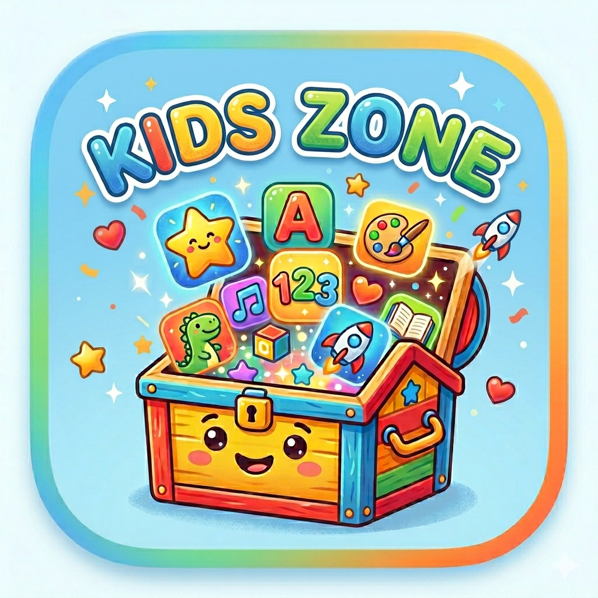
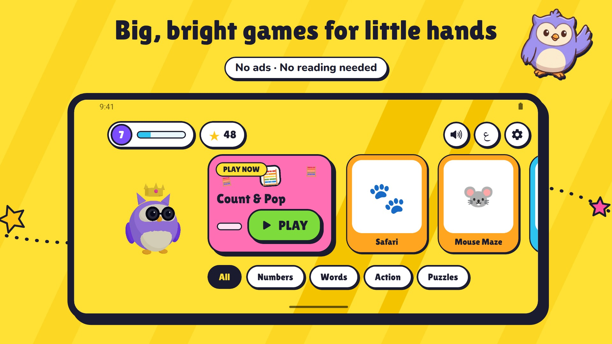
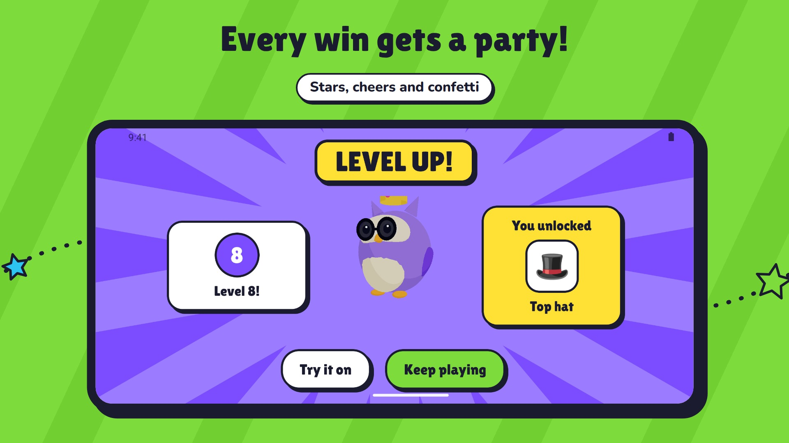
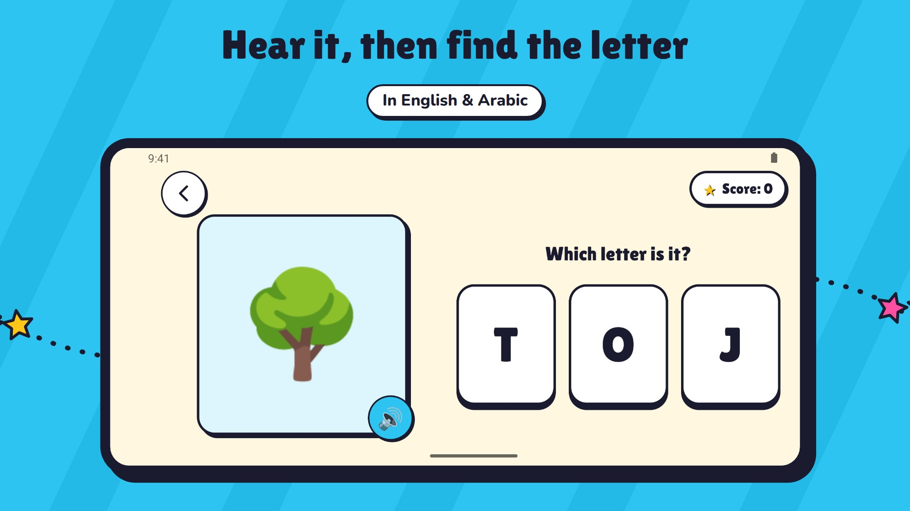
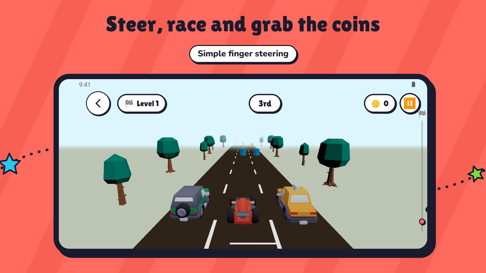
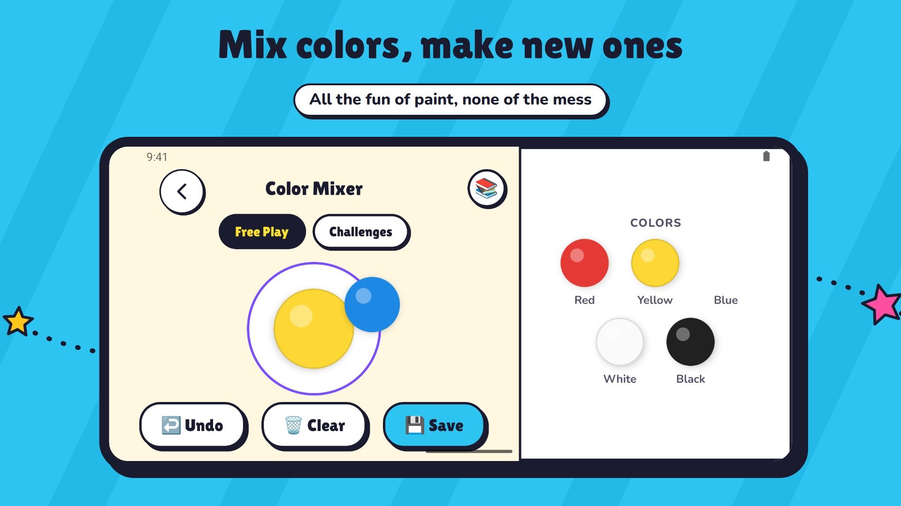
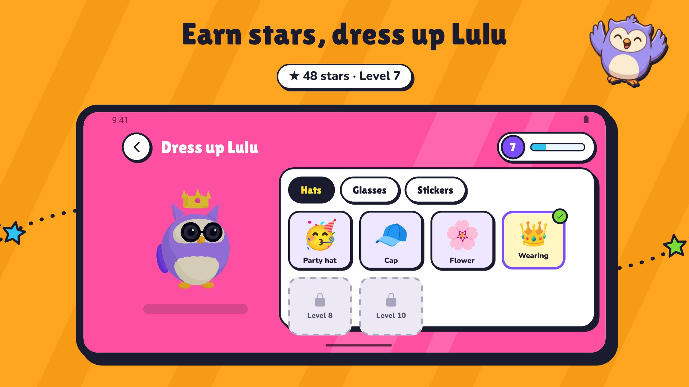
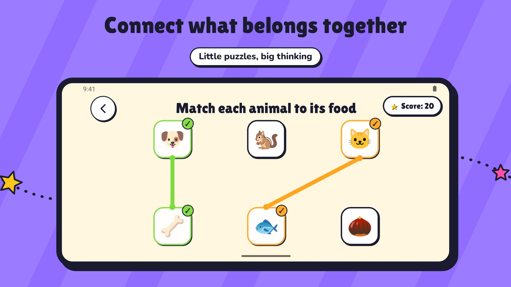
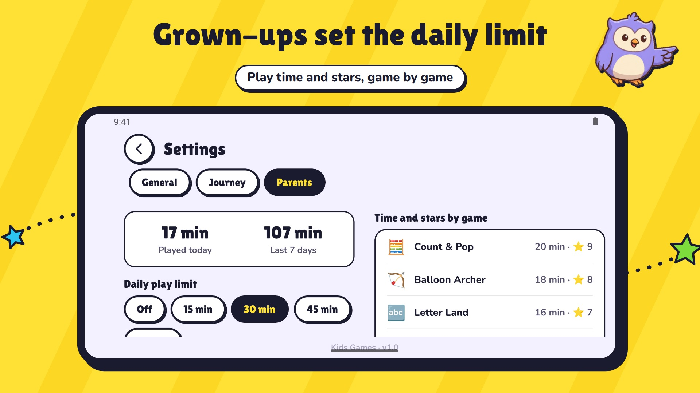

<p align="center">
  
</p>

# Kids Games

A multi-game Expo React Native app for young children (ages 2–12) — 12 bright, ad-free
learning games in English and Arabic (full RTL), built on a shared SDK. Published as
**Kids Zone** on Google Play and the App Store.

<p align="center">
  <a href="https://onesmartlink.app/kids-zone">
    
  </a>
  <br />
  <sub>One link — opens the right store for your device: <a href="https://onesmartlink.app/kids-zone">onesmartlink.app/kids-zone</a></sub>
</p>

<p align="center">
  <a href="https://play.google.com/store/apps/details?id=dev.waybeyond.kidszone">
    
  </a>
  <a href="https://apps.apple.com/app/id6793942277">
    
  </a>
</p>

## Screenshots

<p align="center">
  
  
</p>
<p align="center">
  
  
</p>
<p align="center">
  
  
</p>
<p align="center">
  
  
</p>

## Quick start

```bash
npm install   # if peer-dep conflicts appear, use: npm install --legacy-peer-deps
npx expo start
```

Then open in Expo Go on your device, or press `a` for Android emulator / `i` for iOS simulator /
`w` for web (or `npm run web`). The app runs **landscape-only** on Android, iOS and the web.

```bash
npx tsc --noEmit                 # type check (strict)
CI=1 npx jest --watchAll=false   # unit tests
```

**Add a game:** copy `src/games/_template` → `src/games/your-game`, set up `config.ts`
(`registerGame()` from `@/sdk`), build `index.tsx` importing only from `@/sdk`, and add a
side-effect import in `src/games/index.ts`. Full guide: [docs/GAMES.md](docs/GAMES.md).

## Documentation

| Guide | What's in it |
|-------|--------------|
| [Setup & builds](docs/SETUP.md) | Full setup, Expo Go on a phone, local and EAS cloud builds |
| [Architecture](docs/ARCHITECTURE.md) | Tech stack, source layout, the `@/sdk` surface |
| [Design system](docs/DESIGN_SYSTEM.md) | "Pop Quest" tokens and UI primitives |
| [Games](docs/GAMES.md) | Game catalogue and adding a new game |
| [Releasing](docs/RELEASING.md) | Play + App Store listings, screenshots, sideload APK |
| [Contributing](CONTRIBUTING.md) | SDK contract, tests, asset tags, config rules |

All guides: [docs/](docs/README.md).

## License

The **code** is licensed under the [Apache License 2.0](LICENSE). You're welcome
to build your own games on top of it, fork it, and publish — including for your
own kids. Per the [`NOTICE`](NOTICE) file, derivative works must keep the
attribution ("Based on the Kids Games project").

The **"Kids Games" name, logo, and app icon are reserved** and are *not* covered
by the code license (Apache-2.0 §6). Please use a different name and branding for
your own published builds.

Bundled third-party assets keep their own licenses — see [CREDITS.md](CREDITS.md).
